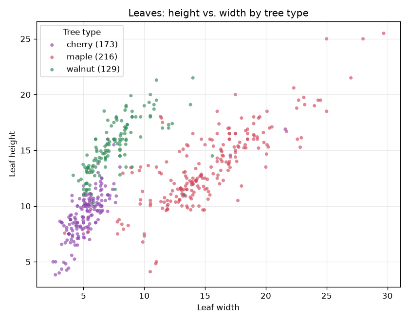

## Data {.smaller}

```{python}
#| include: false
# Every number on these slides is read from data/leaves.csv and ml-study/results/*.csv.
from IPython.display import HTML
from report_data import confusion_html, cv_table, f3, html_table, load_all, test_table
d = load_all()
counts = ", ".join(f"{n} {c}" for c, n in d["class_counts"].items())
recall = ", ".join(f"{c} {f3(r)}" for c, r in d["recall"].items())
```

:::: {.columns}
::: {.column width="62%"}

:::
::: {.column width="38%"}
- `{python} d["n_rows"]` leaves: `{python} counts`
- `{python} d["n_dupes"]` exact duplicates removed → `{python} d["n_dedup"]` rows
- Stratified split (seed `{python} d["seed"]`): `{python} d["n_train"]` training, `{python} d["n_test"]` test rows
- Maple separates by width; cherry and walnut overlap
:::
::::

## Model comparison and baseline {.smaller}

```{python}
HTML(html_table(cv_table(d)))
```

- `{python} d["n_folds"]`-fold stratified CV on the training rows, balanced accuracy; baseline `{python} f3(d["base_cv"])`
- Real models: `{python} f3(d["real_min"])`–`{python} f3(d["real_max"])`, a spread smaller than one CV std
- Within `{python} d["margin"]` of the best, the simplest wins: **`{python} d["chosen"]` (`{python} d["chosen_params"]`)**

## Test score vs. cross-validation {.smaller}

```{python}
HTML(html_table(test_table(d)))
```

- Test balanced accuracy **`{python} f3(d["test_ba"])`**, `{python} f"{abs(d['gap']):.3f}"` below the CV estimate (`{python} f3(d["cv_mean"])` ± `{python} f3(d["cv_std"])`)
- Baseline on the test set: `{python} f3(d["base_test"])`
- `{python} len(d["noise_in_test"])` of the `{python} d["n_noise"]` suspicious rows from the data report are in the test set; `{python} d["noise_wrong"]` predicted wrong

## Confusion matrix (test set) {.smaller}

```{python}
HTML(confusion_html(d))
```

- Recall per class: `{python} recall`
- Weakest class: **`{python} d["weakest"]`**, `{python} d["weakest_as"][1]` of its test rows predicted as `{python} d["weakest_as"][0]`
- `{python} d["n_wrong"]` of `{python} d["n_test"]` test rows predicted wrong

<style>
.tbl { border-collapse: collapse; font-size: 0.8em; margin: 0 auto; }
.tbl th, .tbl td { border-bottom: 1px solid #ccc; padding: 4px 10px; text-align: right; }
.tbl th:first-child, .tbl td:first-child { text-align: left; }
.confusion td.hit { background: #dafbe1; font-weight: 600; }
</style>
